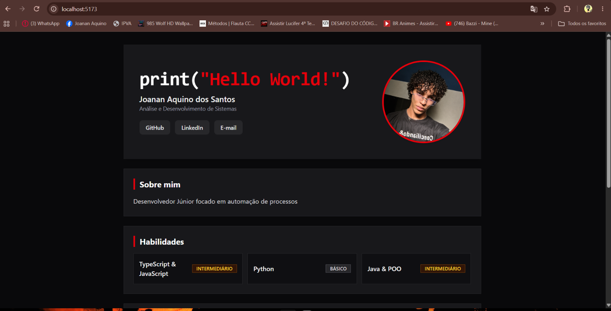

# Meu Portfólio

Projeto de portfólio pessoal desenvolvido para a disciplina de Tecnologias de Interface Web, no curso de Análise e Desenvolvimento de Sistemas (IFTM - Campus Uberaba Parque Tecnológico).

## Preview



## Tecnologias utilizadas

- React
- TypeScript
- Tailwind CSS
- Vite

## O que tem na página

- Cabeçalho com apresentação, foto e links
- Seção "Sobre mim"
- Lista de habilidades com nível de conhecimento
- Cards com meus projetos
- Área de contato

## Como rodar o projeto

1. Clone o repositório:
```bash
git clone [https://github.com/Joanan01/meu-portfolio.git](https://github.com/Joanan01/meu-portfolio.git)
```

2. Entre na pasta do projeto:
```bash
cd meu-portfolio
```

3. Instale as dependências:
```bash
npm install
```

4. Rode o projeto:
```bash
npm run dev
```

## Autor

Feito por **Joanan Aquino dos Santos**.